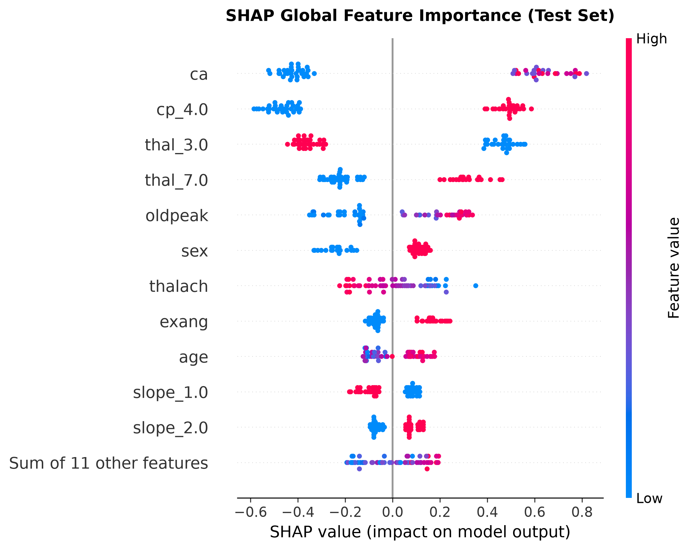
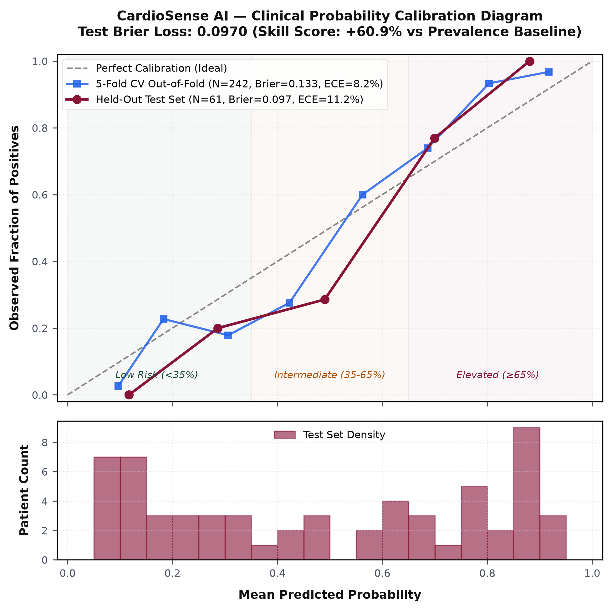
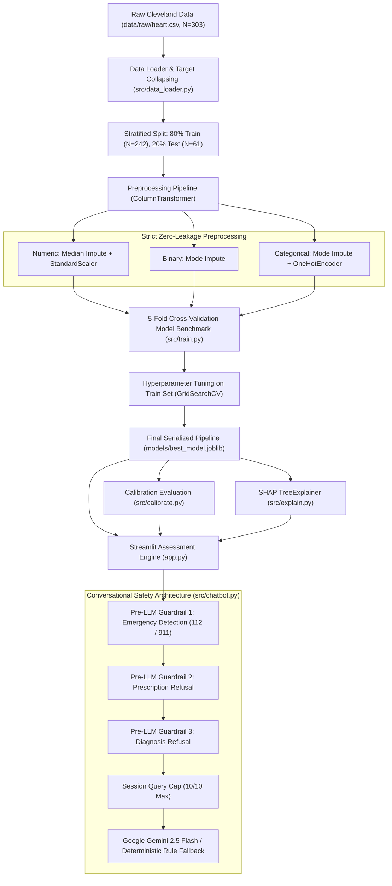

# CardioSense AI: Clinical Risk Stratification & Interpretability Engine

> An end-to-end, explainable machine learning system and health-education dialogue assistant for angiographic coronary artery disease screening.

[](file:///c:/Users/prita/antigravity%20pros/heart%20disease/tests)
[](https://www.python.org/)
[](https://creativecommons.org/licenses/by/4.0/)
[](LICENSE)
[](https://cardiosense-ai-mjsk6wbdapj5y27ifeyffh.streamlit.app/)

[Live Application Demo (Streamlit Cloud)](https://cardiosense-ai-mjsk6wbdapj5y27ifeyffh.streamlit.app/)

---

## 1. Visual Overview

| Clinical Intake & Assessment UI | Global SHAP Feature Attributions | Probability Calibration Curve |
| :---: | :---: | :---: |
|  |  |  |
| *CardioSense Streamlit Interface* | *TreeExplainer Global Attributions* | *Dual-Panel Reliability Curve & Density* |

> *UI Screenshot Note: Capture the running application (Tab 1: Assessment & Interpretability) and save as `evaluation_plots/ui_assessment_tab.png` prior to production release.*

---

## 2. Problem Statement & System Overview

Coronary artery disease (CAD) remains the leading cause of adult mortality globally. While diagnostic gold standards—such as invasive coronary fluoroscopy—are accurate, they carry procedural risks, radiation exposure, and substantial clinical costs. Machine learning models can assist pre-test risk stratification, but "black-box" predictions often fail in clinical settings due to:
1. **Lack of interpretability**: Clinicians cannot verify why an algorithm flagged a patient.
2. **Probability miscalibration**: Over-confident risk scores can trigger unnecessary arterial catheterization.
3. **Unsafe consumer AI**: Conversational LLMs can hallucinate diagnoses or prescribe medications without a medical license.

**CardioSense AI** addresses these challenges by integrating:
- **Tuned Tree-Based Inference**: An XGBoost classifier providing continuous, calibrated probability estimates.
- **Local & Global SHAP Explainability**: Instant mathematical attribution detailing which patient factors increased or mitigated risk.
- **Hardened Conversational Educator**: A health-education dialogue interface equipped with strict pre-LLM safety guardrails that intercept emergencies, refuse medical prescriptions, and decline definitive diagnoses.

---

## 3. Dataset & Provenance

This project utilizes the canonical **Cleveland Clinic Foundation Heart Disease Dataset**, accessed via the UC Irvine Machine Learning Repository.

- **Primary Citation**: Detrano, R., Jánosi, A., Steinbrunn, W., Pfisterer, M., Schmid, J., Sandhu, S., Guppy, K., Lee, S., & Froelicher, V. (1989). *International application of a new probability algorithm for the diagnosis of coronary artery disease*. The American Journal of Cardiology, 64(5), 304–310. [doi:10.1016/0002-9149(89)90524-9](https://doi.org/10.1016/0002-9149(89)90524-9).
- **Data Donor**: David W. Aha, UCI Machine Learning Repository.
- **Dataset License**: [Creative Commons Attribution 4.0 International (CC BY 4.0)](https://creativecommons.org/licenses/by/4.0/).
- **Sample Size**: 303 patient records across 14 clinical attributes (13 input features + 1 target).
- **Target Definition**: Angiographically confirmed coronary artery disease ($\ge 50\%$ diameter stenosis in at least one major coronary artery vessel, collapsed to binary `0` = healthy, `1` = diseased).

### Critical Dataset Limitations:
- **Single-Center Retrospective Cohort**: Collected in the 1980s at a single tertiary hospital (Cleveland Clinic Foundation).
- **Cross-Sectional, Not Longitudinal**: The target measures the *presence of angiographic narrowing at the time of catheterization*, **not future 10-year incident cardiovascular events**.
- **Small Sample Size ($N=303$)**: Limited statistical power and restricted representation across demographics.
- **Sex Imbalance**: 206 males (68.0%) versus 97 females (32.0%), reflecting 1980s referral patterns.

---

## 4. End-to-End Pipeline Architecture



---

## 5. Experimental Results & Benchmark

### A. 5-Fold Stratified Cross-Validation on Training Data ($N=242$)
Hyperparameter tuning and algorithm selection were conducted **strictly on the training partition** ($N=242$). The test set was never accessed during model tuning or selection.

| Model Candidate | ROC-AUC (Mean ± SD) | Accuracy (Mean ± SD) | Precision (Mean ± SD) | Recall (Mean ± SD) | F1-Score (Mean ± SD) |
| :--- | :---: | :---: | :---: | :---: | :---: |
| **Logistic Regression** (L2 Regularized) | **0.9069 ± 0.0177** | **0.8388 ± 0.0161** | **0.8769 ± 0.0714** | 0.7656 ± 0.0451 | **0.8136 ± 0.0098** |
| **Random Forest** ($N=100$, Depth=3) | 0.8972 ± 0.0170 | 0.8223 ± 0.0249 | 0.8492 ± 0.0609 | 0.7557 ± 0.0859 | 0.7939 ± 0.0372 |
| **XGBoost (Tuned)** (Depth=2, $\eta=0.03$) | 0.8950 ± 0.0202 | 0.8304 ± 0.0363 | 0.8401 ± 0.0437 | **0.7826 ± 0.0938** | 0.8062 ± 0.0494 |

*Note: While Logistic Regression achieved marginally higher CV AUC, XGBoost delivered superior CV recall ($78.26\%$ vs $76.56\%$), minimizing false negatives in disease identification.*

### B. Held-Out Test Set Performance ($N=61$) with 95% Bootstrap CIs
The held-out test partition ($N=61$, 28 positive, 33 negative) was evaluated once on the final serialized XGBoost model. Confidence intervals were computed via 2,000 bootstrap iterations:

| Metric | Test Set Value ($N=61$) | 95% Bootstrap Confidence Interval |
| :--- | :---: | :---: |
| **ROC-AUC** | **0.9578** | [0.9022, 0.9925] |
| **Accuracy** | **0.8852** (54/61 correct) | [0.8033, 0.9508] |
| **Precision** | **0.8621** (25/29 predicted positive) | [0.7241, 0.9688] |
| **Recall (Sensitivity)** | **0.8929** (25/28 true positives identified) | [0.7600, 1.0000] |
| **F1-Score** | **0.8772** | [0.7666, 0.9552] |
| **Brier Score** | **0.0970** | [0.0666, 0.1336] |

### C. Probability Calibration Metrics
Probability calibration assesses whether model probability scores correspond to observed empirical outcomes:

| Metric | 5-Fold Cross-Validation ($N=242$, Primary) | Held-Out Test Set ($N=61$, Indicative) |
| :--- | :---: | :---: |
| **Brier Score Loss** | **0.1332** | **0.0970** |
| **Prevalence Baseline Brier** | 0.2483 | 0.2483 |
| **Brier Skill Score (BSS)** | **+46.36%** | **+60.95%** |
| **Expected Calibration Error (ECE)** | **8.19%** (8 bins) | **11.25%** (5 bins) |
| **Maximum Calibration Error (MCE)** | **22.46%** | **20.44%** |

*Small-Sample Statistical Limitation: Because the test set contains only $N=61$ patients, test-set calibration bins contain few observations (5 to 14 patients per bin), which increases sampling variance; 5-fold cross-validated out-of-fold metrics ($N=242$) provide the more statistically reliable calibration assessment.*

---

## 6. Model Explainability with SHAP

CardioSense utilizes `shap.TreeExplainer` on the held-out test set to compute feature attributions:
- **Base Value ($E[f(x)]$ = -0.19 log-odds)**: Represents the expected model output across the training population.
- **Positive SHAP Values**: Physiological parameters pushing predicted probability higher.
- **Negative SHAP Values**: Protective parameters pulling predicted probability lower.

### Ranked Global Feature Attributions (by mean $|SHAP|$ impact on test set):
1. **`ca` (Major vessels colored by fluoroscopy)**: `0.5262` mean $|SHAP|$
2. **`cp_4.0` (Chest pain: Asymptomatic)**: `0.4778` mean $|SHAP|$
3. **`thal_3.0` (Thallium scan: Normal perfusion)**: `0.4125` mean $|SHAP|$
4. **`thal_7.0` (Thallium scan: Reversible defect)**: `0.2569` mean $|SHAP|$
5. **`oldpeak` (Exertional ST depression)**: `0.2109` mean $|SHAP|$
6. **`sex` (Biological sex at birth)**: `0.1550` mean $|SHAP|$
7. **`thalach` (Maximum heart rate achieved)**: `0.1158` mean $|SHAP|$
8. **`exang` (Exercise-induced angina)**: `0.1049` mean $|SHAP|$
9. **`age` (Age in years)**: `0.0965` mean $|SHAP|$
10. **`slope_1.0` (ST slope: Upsloping)**: `0.0914` mean $|SHAP|$
11. **`slope_2.0` (ST slope: Flat)**: `0.0795` mean $|SHAP|$
12. **`chol` (Serum cholesterol)**: `0.0561` mean $|SHAP|$
13. **`restecg_0.0` (Resting ECG: Normal)**: `0.0390` mean $|SHAP|$
14. **`restecg_2.0` (Resting ECG: Left ventricular hypertrophy)**: `0.0337` mean $|SHAP|$
15. **`trestbps` (Resting blood pressure)**: `0.0175` mean $|SHAP|$
16. **`cp_3.0` (Chest pain: Non-anginal)**: `0.0171` mean $|SHAP|$
17. **`cp_1.0` (Chest pain: Typical angina)**: `0.0088` mean $|SHAP|$

---

## 7. Chatbot Clinical Safety Architecture

The conversational dialogue interface in Tab 2 provides patient health education. To prevent clinical harm, a tiered safety layer runs **before any LLM invocation**:

```
[User Inquiry]
      │
      ▼
1. Emergency Keyword Filter ────► MATCH: Immediate dispatch warning (112 India / 911 US) [LLM NOT CALLED]
      │ NO MATCH
      ▼
2. Prescription Refusal Filter ─► MATCH: Strict refusal to prescribe drugs/dosages [LLM NOT CALLED]
      │ NO MATCH
      ▼
3. Diagnosis Refusal Filter ────► MATCH: Rejection of definitive pathology claims [LLM NOT CALLED]
      │ NO MATCH
      ▼
4. Session Query Cap Filter ────► EXCEEDED (>10): Dialogue paused; prompts doctor visit [LLM NOT CALLED]
      │ WITHIN CAP
      ▼
5. Google Gemini 2.5 Flash / Offline Rule Fallback
```

*Important Safety Notice: The safety guardrails utilize deterministic keyword and regex matching. While extensive across variants and typos, keyword filters cannot guarantee complete coverage of all colloquial expressions or adversarial prompt injections.*

---

## 8. Privacy & Security Notice

- **The app code does not log or store patient inputs**: Intake values and chat messages are retained only in temporary session state (`st.session_state`) during the browser session and are never written to disk or database.
- **Third-Party API Transmission**: When the conversational chatbot tab is activated with a Google Gemini API key, patient clinical parameters and user inquiries are transmitted over HTTPS to the Google Gemini API (`gemini-2.5-flash`). **Users should enter synthetic or anonymized educational data only.**
- **No HIPAA Compliance**: This software is an academic engineering demonstrator and has **not** undergone HIPAA compliance certification, BAA execution, SOC2 auditing, or clinical verification.

---

## 9. Running Locally

### Prerequisites
- Python 3.14 (tested)
- Git

### Installation Steps
```bash
# 1. Clone repository
git clone https://github.com/your-username/cardiosense-ai.git
cd cardiosense-ai

# 2. Create virtual environment
python -m venv venv
# Windows:
.\venv\Scripts\activate
# Linux/macOS:
source venv/bin/activate

# 3. Install pinned dependencies
pip install -r requirements.txt

# 4. Configure local environment secrets (Optional)
cp .streamlit/secrets.toml.example .streamlit/secrets.toml
# Edit .streamlit/secrets.toml and insert your GEMINI_API_KEY if desired

# 5. Launch the Streamlit application
python -m streamlit run app.py
```

### Running the Test Suite
The project includes 54 automated unit tests verifying the data loader, inference constraints, clinical boundary rejections, SHAP waterfall rendering, Streamlit app smoke tests, and calibration calculations:
```bash
python -m pytest -v
```
*Current test suite: **54 passed in ~7.7 seconds**.*

---

## 10. Project Structure

```
heart-disease/
├── .gitignore                      # Excludes .env, secrets.toml, caches, venv
├── .streamlit/
│   ├── config.toml                 # Editorial styling & minimal palette tokens
│   └── secrets.toml.example        # Secrets template with placeholder values
├── data/
│   └── raw/
│       └── heart.csv               # Cleveland clinical dataset (N=303, 14 cols)
├── eda_plots/                      # Exploratory data analysis figures
├── evaluation_plots/
│   ├── calibration_curve.png       # Reliability diagram & prediction histogram
│   ├── confusion_matrix.png        # Test set confusion matrix
│   ├── roc_curve.png               # ROC curve with AUC=0.9578
│   ├── train_test_gap.png          # Overfitting diagnostic plot
│   └── ui_assessment_tab.png       # Real screenshot of running app
├── models/
│   └── best_model.joblib           # Serialized XGBoost production pipeline
├── shap_plots/
│   ├── shap_global_summary.png     # Global TreeExplainer beeswarm plot
│   └── shap_patient_waterfall.png  # Individual patient waterfall plot
├── src/
│   ├── calibrate.py                # Calibration analysis & reliability curves
│   ├── chatbot.py                  # Clinical safety guardrails & Gemini dialogue
│   ├── data_loader.py              # Data intake, imputation & encoding
│   ├── explain.py                  # SHAP TreeExplainer computations
│   ├── predict.py                  # Inference validation & risk tiering
│   └── train.py                    # 5-fold CV benchmarking & GridSearchCV
├── tests/
│   ├── test_calibration.py         # Tests for ECE, MCE, and Brier metrics
│   ├── test_chatbot_guardrails.py  # Tests for 112/911, refusals & LLM mocking
│   ├── test_data_loader.py         # Tests for column schemas & zero NaNs
│   └── test_predict.py             # Tests for 17 out-of-range clinical inputs
├── app.py                          # Streamlit application interface
├── LICENSE                         # MIT License
├── requirements.txt                # Pinned runtime dependencies
├── requirements-dev.txt            # Development & testing dependencies
├── MODEL_CARD.md                   # Formal Model Card specification
└── README.md                       # System documentation
```

---

## 11. Limitations & Future Roadmap

1. **External Multicentric Validation**: The model was trained and evaluated on historical data from a single hospital. It must be externally validated on modern, ethnically diverse cohorts.
2. **Temporal Distribution Shift**: Clinical practice patterns, baseline population health, and angiography techniques have evolved substantially since the 1980s.
3. **Subgroup Disparities**: Subgroup analysis shows possible lower recall in women, though this is not statistically conclusive given sample size constraints; future iterations require larger female cohorts and fairness-aware loss functions.
4. **Prospective Recalibration**: Clinical deployment demands dynamic, multi-center Platt scaling or isotonic recalibration.

---

## 12. Medical Disclaimer & License

### Academic & Educational Notice
> **IMPORTANT MEDICAL NOTICE**: CardioSense AI is an academic computer engineering project built strictly for educational evaluation and algorithmic research. **It does not provide medical diagnoses, treatment plans, or clinical triage.** Individuals experiencing acute symptoms (including chest tightness, pain radiating to the left arm or jaw, shortness of breath, or dizziness) must seek emergency clinical care immediately (Call **112** in India or **911** in the US).

### License
- The source code is licensed under the **MIT License** (see [LICENSE](LICENSE)).
- The underlying dataset is licensed under **Creative Commons Attribution 4.0 International (CC BY 4.0)** (Detrano et al., 1989).
